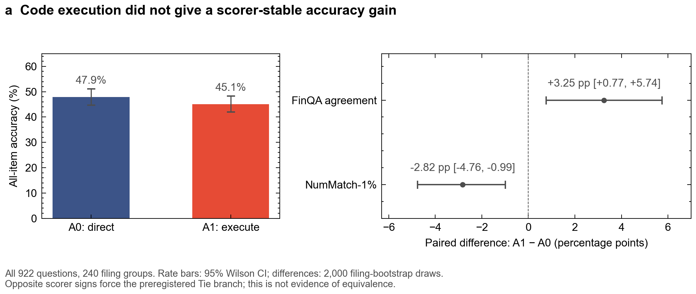
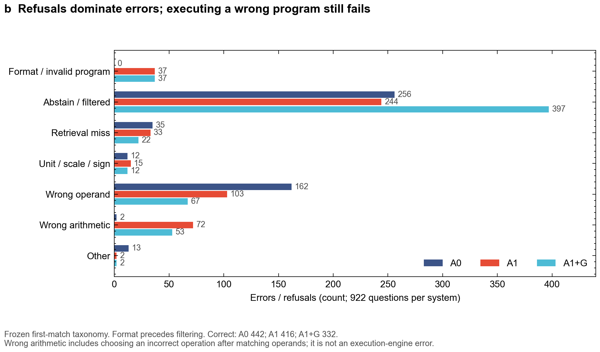
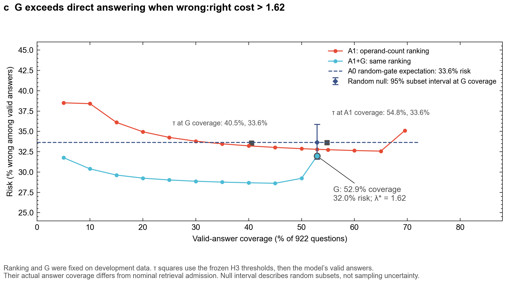
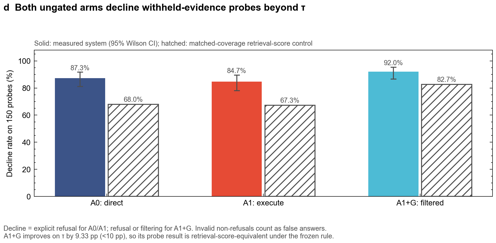
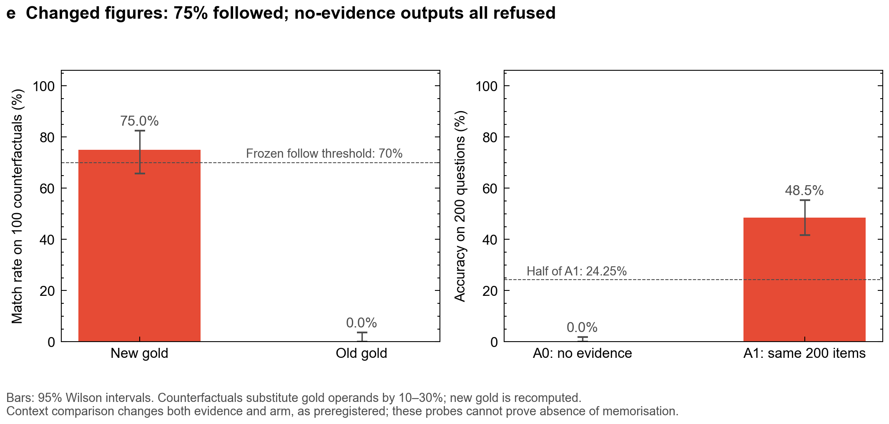

# Frozen stage-2 results

**The hierarchy selects H3′: A1 declined 127/150 (84.67%) withheld-evidence probes, versus 67.27% for its matched retrieval-score control. Both ungated arms pass H3′, and the counterfactual/context check permits the probe clause. H0 is a scorer-dependent Tie; H1 fails.**

Run `stage2-v2-20261018` completed all nine blocks: A1 922, A0 922, withheld A1 150, withheld A0 150, no-evidence 200, determinism 30, counterfactual 100, FinanceBench 226, oracle 200. The process exited; the final log reaches oracle 200/200. All 2,900 requests were sent, with zero generation errors. Wall time was 17,413.20 s (4 h 50 min 13 s); no blocks were cut by the six-hour rule. This was one frozen evaluation run, including the planned 30-item repeat. No test block was rerun during reporting.

The authoritative estimates and decisions are in [analysis.json](results/analysis.json), produced by the original frozen analysis; this copy renames a presentation field while preserving all numerical values. Paired 95% intervals use 2,000 filing-level bootstrap draws, seed 20261018. All reported paired intervals have 2,000 valid draws and zero undefined draws. Secondary Wilson intervals describe individual rates; they do not replace clustered analysis or frozen point thresholds. No multiplicity correction was preregistered.

## Verdict table

| Hypothesis | Estimate and 95% interval | Frozen verdict |
|---|---|---|
| H0: A1 − A0 primary accuracy | −2.82 pp [−4.76, −0.99]; 45.12% vs 47.94% | **Tie, scorer-dependent**. Primary-only branch is Lose; FinQA Δ +3.25 pp [+0.77, +5.74] forces downgrade to Tie |
| H1: G precision gain over the better ungated arm's answered precision | 68.03% − 66.37% = +1.67 pp [−1.57, +4.93]; G coverage 52.93% [49.70, 56.13] | **Fail**. Misses partial gain ≥8 pp and lower bound >0, as well as full criteria |
| H3′: headline A1 withheld false-answer rate | 23/150 = 15.33% [10.44, 21.96]; τ 32.73%; advantage 17.39 pp | **Pass**: ≥80 validated probes, point ≤20%, main non-refusal coverage 73.54% ≥70%, advantage ≥10 pp |
| H3′: A0 withheld false-answer rate | 19/150 = 12.67% [8.26, 18.94]; τ 32.00%; advantage 19.33 pp | **Pass**; main coverage 72.23% ≥70% |
| H3′: A1+G withheld false acceptance | 12/150 = 8.00% [4.64, 13.46]; τ 17.33%; advantage 9.33 pp | **Fail / retrieval-score-equivalent**. Misses 10 pp; H1 did not establish eligibility. Secondary point ≤10% passes |
| H2: follows substituted operands | 75/100 = 75.00% [65.70, 82.45]; old-gold matches 0/100 [0, 3.70] | **Pass** with the context check; frozen ≥70% point threshold |
| H2: no-evidence context dependence | 0/200 = 0% [0, 1.88], vs A1 97/200 = 48.50% [41.67, 55.39] on the same IDs | **Pass**: 0 ≤ half of 48.50% (24.25%). No recall caveat triggered by the frozen rule |
| H4: gold-page oracle | 135/200 = 67.50% [60.73, 73.61]; paired gain +19.00 pp [+13.04, +25.21] | **Descriptive only**; 65 still wrong despite supplied gold-page evidence |
| FinanceBench answerable, A1 | 17/76 = 22.37% [14.46, 32.93]; G precision 12/13 = 92.31% [66.69, 98.63] at 13/76 coverage | **Descriptive only**; no frozen success threshold |
| FinanceBench wrong-company controls, A1 | 146/150 explicit refusals = 97.33% [93.34, 98.96]; G 0/150 false accepts [0, 2.50] | **Easy control**. Trivial metadata filter declines all 150; no headline claim |
| Determinism rerun | Parsed agreement 29/30 = 96.67% [83.33, 99.41]; exact text 18/30 = 60.00% [42.32, 75.41] | **Pass** (at least 28/30 parsed agreement); not exact-text determinism |
| Absolute-accuracy clause | A0 NumMatch 47.94%, FinQA 43.28%; A1 45.12%, 46.53% | **Eligible** for qualified historical-reference wording; does not lead or establish superiority |

## Frozen decision rules

1. H0 primary upper bound −0.99 pp <0 gives Lose. Opposite FinQA sign (+3.25 pp) forces **Tie** under §B.
2. H1 gain 1.67 pp and lower bound −1.57 pp fail both thresholds. No filtering clause is allowed. With H0 Tie and H1 Fail, the headline system defaults to **A1**.
3. A1 H3′ passes: 150 validated probes, 15.33% false answers, 73.54% main non-refusal coverage, 17.39 pp beyond τ.
4. H2 passes: 75% follow substituted values and 0% no-evidence accuracy. Both A0 and A1 false-answer rates are ≤20%, selecting **both_decline** with headline A1's 84.67% decline rate.
5. §A therefore selects **H3′ lead**, followed by the required H0 null and decomposition. Pooled reading-error operand share is 69.55%, but arithmetic share is 19.42% (>15%); operand-only wording is disallowed. The modal category is abstain/filtered: 500/986 pooled errors = 50.71%.
6. The lower-priority absolute clause remains eligible under the frozen rule; the historical reference is confined to the [related-work table](README.md#limitations-and-protocol-labelled-related-work) in the current write-up. The scientific decision thresholds are preserved in `PREREG_v2.md`; publication-only wording has been removed or generalized. H4 is write-up only. No historical comparison is a paired win.

## Main scores and paired table

| System | Correct / all 922 | NumMatch-1% (95% Wilson CI) | NumMatch-strict | FinQA agreement | Valid answered | Answered precision | Explicit abstain | Unparseable / truncated |
|---|---:|---|---:|---:|---:|---:|---:|---:|
| A0 direct | 442 | 47.94% [44.73, 51.17] | 47.51% | 43.28% (399/922) | 666 | 66.37% | 256 (27.77%) | 0 / 0 |
| A1 execute | 416 | 45.12% [41.93, 48.34] | 43.93% | 46.53% (429/922) | 641 | 64.90% | 244 (26.46%) | 36 / 1 |
| A1+G | 332 | 36.01% overall | 35.14% | 37.74% (348/922) | 488 | 68.03% [63.77, 72.02] | 244 underlying | 37 underlying format errors |

All abstentions, invalid outputs, truncations and filtered outputs count as wrong overall. A1+G has 434 nonanswers. Its 397 abstain/filtered taxonomy rows exclude 37 earlier-priority format rows. FinQA agreement uses all 922 eligible joins here; it is a different gold/scoring convention.

**Post hoc, descriptive scorer disagreement:** NumMatch-1% and FinQA correctness differ on 91/922 A1 items (9.9%) and 133/922 A0 items (14.4%). Of the 91 A1 flips, 77 are percent-type predictions (`prediction_type = 2`). These counts come from comparing the two correctness columns in `results/A1.csv` and `results/A0.csv`. They do not adjudicate semantic correctness or change the frozen verdict.

| | A1 correct | A1 wrong | Total |
|---|---:|---:|---:|
| A0 correct | 392 | 50 | 442 |
| A0 wrong | 24 | 456 | 480 |
| Total | 416 | 506 | 922 |

Only A0 is correct on 50/922 = 5.42% [3.91, 7.04]; only A1 on 24/922 = 2.60% [1.57, 3.69]. Their sum gives 74/922 = 8.03% disagreement in correctness. These intervals use filing bootstrap. Answered-conditional Δ is −1.47 pp [−3.79, +0.86]. Its sign agrees with the overall Δ, so the extra scientific summary abstention parenthesis is not triggered. On the **752 operands-retrieved items**, Δ is −3.46 pp [−5.73, −1.28].

## Error taxonomy per arm

Frozen first-rule-wins classification; each column sums to 922 including correct. “Wrong arithmetic” includes a wrong arithmetic program with matched operand values, not an incorrect result from the code interpreter.

| Category | A0 | A1 | A1+G |
|---|---:|---:|---:|
| Correct | 442 | 416 | 332 |
| 1. Format / invalid program / truncation | 0 | 37 | 37 |
| 2. Abstain / filtered | 256 | 244 | 397 |
| 3. Retrieval miss | 35 | 33 | 22 |
| 4. Unit / scale / sign | 12 | 15 | 12 |
| 5. Wrong operand | 162 | 103 | 67 |
| 6. Wrong arithmetic | 2 | 72 | 53 |
| 7. Other | 13 | 2 | 2 |
| All errors | 480 | 506 | 590 |

| Abstain / filtered split | A0 | A1 | A1+G |
|---|---:|---:|---:|
| 2a: at least one gold operand absent | 125 | 125 | 137 |
| 2b: all gold operands present | 128 | 117 | 257 |
| Unknown operand annotation | 3 | 2 | 3 |

Both arms were instructed to abstain only if a required number was missing, not because arithmetic or unit conversion was needed (`qa_v2.py`, `SYSTEM_V2`, `A0_V2`, `A1_V2`). The frozen diagnostic labels abstentions with all gold figures numerically present “unjustified”: A1 117/922 = 12.7% and A0 128/922 = 13.9% of all main questions. The denominator is all 922 questions, not only the operand-present subset; numeric presence does not guarantee semantic sufficiency.

A0's reasoning-based taxonomy and A1's declared/executed-operand taxonomy are different deterministic diagnostics. Numeric matches do not establish semantic correctness; category differences do not isolate a causal mechanism. A1 has 677 non-refusal numeric self-answer diagnostics: both correct 385, execution only 31, self only 24, both wrong 237. Of execution-only cases, 28 have a matched operand set. Self-answer affects neither scoring nor G. The A1+G copy covers the same underlying outputs, not just accepted items.

## Accuracy decomposition

Gold operands are detected in supplied evidence for 752/922 = 81.56%. Seven items have unknown annotations; 163 have a detected missing operand. This uses the frozen 1% numeric tolerance and supplied headers, not the earlier near-exact development diagnostic.

| Arm | P(retrieved) × P(correct given retrieved) | Contribution | Nonretrieved/unknown correct residual | Total |
|---|---|---:|---:|---:|
| A0 | 81.56% × 58.11% (437/752) | 47.40% (437/922) | 0.54% (5/922) | 47.94% |
| A1 | 81.56% × 54.65% (411/752) | 44.58% (411/922) | 0.54% (5/922) | 45.12% |

A1 is wrong on 341/752 questions with all gold figures numerically present (752 − 411). Reading and refusal remain substantial in this subset. Supplied numbers alone do not ensure the correct operation. On the same 200 questions, supplying gold-page evidence increased A1 accuracy from 48.5% to 67.5% (+19.0 pp), with 65 errors remaining. This shows substantial room to improve evidence retrieval; it does not establish retrieval as the dominant source of error. The product alone is not total accuracy; dropping the residual breaks the identity.

## Selective answering, random gate and cost break-even

G accepts 488/922 (52.93%) and answers 332/488 correctly (68.03%). A0 is the comparator because it has higher all-item primary accuracy. Its own 666 answers have 442/666 = 66.37% precision. The relevant gain is **1.67 pp [−1.57, 4.93]**; comparison against A0 overall accuracy gives 20.09 pp and is not used for H1.

The random null draws 1,000 subsets of size 488 from A0's 666 answered items, seed 20261018. Mean precision is 66.35%; the 95% subset interval is [64.14, 68.44]. The one-sided empirical upper-tail probability is 0.080919. G does not exceed comparator answer coverage and was not subsampled. This interval is a null distribution, not a population CI.

Curves use development-selected `operand_count`, descending. Ties receive common fractional weights, without correctness-based tie-breaking. Every coordinate and cost crossing is in `analysis.json` under `risk_coverage` and `risk_coverage_G`. The separately frozen G point supplies the clause decision; no favorable point was selected from the test curve.

With correct reward 1, wrong-answer cost λ and refusal value 0, per-question expected value is `coverage × (precision − λ × (1 − precision))`. G minus A0 equals **−110/922 + λ × 68/922**, so G exceeds A0 only at **λ > λ* = 110/68 = 1.61765**. This is a sample plug-in break-even, not a deployment guarantee or a cost estimate. No CI for λ* was preregistered. Ungated A1 never exceeds A0 for nonnegative λ in this sample.

| Operating point | Valid-answer coverage | Risk among answers | λ* versus A0 |
|---|---:|---:|---:|
| A0 answered baseline | 72.23% | 33.63% | Comparator |
| A1 ungated | 69.52% | 35.10% | Never for λ ≥0 |
| A1 operand-count ranking at G coverage | 52.93% | 32.80% | 1.78332 |
| Fixed G | 52.93% | 31.97% | 1.61765 |
| A1 ranking at 50% coverage | 50.00% | 32.87% | 1.82937 |
| A1+G ranking at 50% coverage | 50.00% | 29.23% | 1.29633 |

The τ squares apply frozen H3 thresholds to test retrieval scores, followed by the model's valid-answer condition. A1-calibrated τ admits 73.54% by score and yields **54.83% valid-answer coverage / 33.62% risk**. G-coverage-calibrated τ admits 52.93% by score and yields **40.55% / 33.56%** with ungated A1. They are retrieval-score alternatives to G, not intersections with G. Nominal admission and actual answering differ. These display coordinates are in `supplemental.json`; no new threshold or verdict was selected.

## Withheld-evidence probes

All 150 probes passed frozen numeric validation. Gold is refusal. “False answer” includes every non-abstain output, including invalid ones; G false acceptance requires a valid accepted answer. A1's H3 main coverage is **678 non-refusals /922 = 73.54%**; ordinary valid-answer coverage is 641/922 = 69.52%. The frozen H3 rule deliberately uses the former.

| System | False answers / accepts (95% Wilson CI) | Decline rate (95% Wilson CI) | Explicit refusal | Invalid non-refusal | τ decline | Advantage beyond τ |
|---|---|---|---:|---:|---:|---:|
| A0 | 19/150; 12.67% [8.26, 18.94] | 87.33% [81.06, 91.74] | 131 | 0 | 68.00% | 19.33 pp |
| A1 | 23/150; 15.33% [10.44, 21.96] | 84.67% [78.04, 89.56] | 127 | 2 | 67.27% | 17.39 pp |
| A1+G | 12/150; 8.00% [4.64, 13.46] | 92.00% [86.54, 95.36] | 127 underlying | 2 underlying, filtered | 82.67% | 9.33 pp |

A1 has 21 valid non-refusals plus two invalid outputs. G retains 12 valid non-refusals; its 138 other outcomes are refusals or filtering. τ uses highest fused BM25+dense RRF(60) scores among supplied chunks. A0 and A1 share τ=0.032018442622950824 with boundary weights 0.5 and 0.7727272727272727; G uses τ=0.03252247488101534 with weight 0.8461538461538465. Fractional ties match each system's main coverage. These τ rates are expected gate outcomes, not binomial samples, so no Wilson interval is attached.

The metadata filter permits 129/150 probes. Within those 129, false-answer/acceptance counts are A0 18 (13.95%), A1 22 (17.05%), G 11 (8.53%). H3 uses all 150 as preregistered. Two A0 false answers match old source gold; A1 and G have zero. These are memorisation flags, not proof.

Validation excludes question-contained operands, empty controls, direct/scaled gold and values derivable by the specified finite pairwise arithmetic search across question, evidence and headers. It cannot establish universal unanswerability. These same-company, same-document probes test a narrower omission setting than real unsupported financial questions.

## Context, counterfactual, oracle and determinism

A1 followed substituted figures in 75 of 100 edited-evidence cases (81 filings) [65.70%, 82.45%], versus zero old-gold matches [0, 3.70%]. There are 88 valid answers, 11 refusals and one invalid non-refusal. Selection used retrieved operands without generated correctness; numeric format and ±10–30% substitutions were validated before generation. The point crosses 70%, although the descriptive interval includes 70%.

A0 refused all 200 no-evidence questions, giving 0% accuracy [0, 1.88%]. A1 on those same IDs reaches 48.50% [41.67, 55.39%]. This passes the frozen check but does not prove the model could not recall answers under another instruction. The comparison also changes arm, as preregistered. No additional recall caveat is triggered by the rule; the design limitation remains.

On the same 200 questions, supplying gold-page evidence increased A1 accuracy from 48.5% to 67.5% (+19.0 pp), with 65 errors remaining. This shows substantial room to improve evidence retrieval; it does not establish retrieval as the dominant source of error. Counts are 135/200 versus 97/200; paired gain CI is [13.04, 25.21] pp.

Of 65 errors, 40 are valid wrong answers, 18 refusals and seven invalid outputs. There are 35 valid wrong answers even with all annotated gold snippets hit. Gold-page BM25 packing may omit relevant text, so “oracle” does not guarantee complete semantic evidence. H4 is descriptive and stays in the write-up.

Oracle prompts averaged 2,253.695 tokens on 200 questions (`runs/stage2-v2-20261018/oracle_summary.json`, `prompt_tokens.mean`, retained outside Git). Main A1 prompts averaged 5,819.009 tokens on 922 questions (`results/analysis.json`, `arms.A1.prompt_tokens.mean`), a 3,565.314-token difference. These are different-sized sets, not a paired token-length comparison. The oracle intervention changes both evidence and context length, so its gain does not isolate retrieval quality.

The saved 30-item repeat agrees on parsed value/type/refusal for 29 items (96.67%; Wilson [83.33, 99.41]) and exact response text for 18 (60.00%; [42.32, 75.41]). It meets ≥28/30 parsed agreement, but one parsed disagreement and twelve text disagreements remain. The parsed disagreement is `test-0514`: 3.1278331822302814 versus 0.03127833182230281, a 100× percent-unit flip at temperature 0 (`A1.csv` and `rerun30.csv`). This stage reads the existing repeat without rerunning it.

## FinanceBench

On 76 answerable numeric items, A1 has 17 correct, 19 valid answers, 50 refusals and seven invalid outputs. Accuracy is 22.37% [14.46, 32.93]. G accepts 13/76 (17.11%; [10.28, 27.10]), with 12 correct: precision 92.31% [66.69, 98.63]. Its all-item accuracy is 12/76 = 15.79%. The small accepted set does not support a broad reliability claim.

All 150 wrong-company probes are rejected by the trivial filter. A1 refuses 146 (97.33%; [93.34, 98.96]); four invalid non-refusals count as false answers (2.67%; complementary CI [1.04, 6.66]). None is a valid answered output; G accepts none (0%; [0, 2.50]). The JSON's `false_answer_rate` on answerable items is simply the non-refusal rate (26/76, including seven invalid outputs), not an error rate.

Historical results on identical 76 IDs, with protocol labels, are in the [README table](README.md#limitations-and-protocol-labelled-related-work) and `supplemental.json`. Human-label and current-parser historical scores stay distinct. The DocFinQA historical reference also uses a different protocol.

## Evidence and implementation record

The [numeric evidence packet](results/) contains one CSV per saved block plus derived A1+G. IDs, numeric predictions, numeric type codes, boolean scores, taxonomy codes and numeric filing-group indices are retained. Questions, filing context, quotes, raw generations and PDF text are excluded. [checksums.sha256](results/checksums.sha256) covers all packet files except itself.

`analyze.py` originally completed with SHA-256 `6f5822bab9d757d160de05c0f1e42d2462ca491061aa22c91bba6499e0f25d05`. This cleaned copy renames a presentation-only field and generalizes machine paths and workflow labels. Numerical results, thresholds and outcome-selection logic are unchanged. Frozen input hashes describe private historical bytes, not replacement hashes for the cleaned code. Original machine metadata and the server environment are not distributed.
